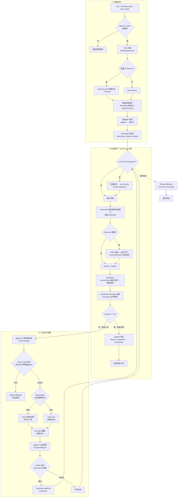

# MoS Agent 执行流程

> 来源：`agent/runtime.go` 的 `run` 实现（M1 ~ M2.7 能力全量）。

## 流程图

## 阶段说明

### ① 准备阶段

- 校验 `planner` / `tools` 已配置，缺失直接返回错误
- 沙箱注入：`tool.WithSandbox(ctx, a.sandbox)`，shell 类工具从 ctx 取沙箱执行
- 历史加载：配置了 `Memory` 时以 `memory.Load` 为准（`fromLlm` 接回内部层），否则用 `sess.History`
- 系统提示：`Assembler` 槽位化组装优先，否则用静态 `systemPrompt`
- 用户输入追加历史并持久化；`TaskState` 首次运行记录 Goal、进入 running

### ② 任务循环（maxTurns 上限，默认 10）

- 每轮（turn≥2）触发 fresh-context 压缩：切割点不切断 ToolCall-Result 对，摘要取 `TaskState.Snapshot()`，压缩后同步会话历史与持久化记忆
- 每轮刷新系统提示（替换 `history[0]`），运行时状态随 TaskState 进度更新
- 配置了 Retriever 时按 Goal 做 RAG 检索，经知识守门后以 `CustomMsg` 注入**当轮发送副本**（不进历史）
- `nextAction` 先经 `convertToLlm` 翻译边界，再调模型（流式/非流式）；`EventContextUsage` 监控 40% Dumb Zone
- 模型直接作答 → 完成（`EventDone`）；请求工具 → 进入工具链路

### ③ 工具执行链路

- Doom Loop 检测：相同工具 + 相同参数连续 ≥3 次 → 中断置 blocked
- `Policy.Allow` 执行前拦截：拒绝则结果回填拒绝说明（不执行）
- `tools.Call` 沙箱内执行；`truncator` 对模型可见文本截断（Auditor 仍审计原始结果）
- 审计门：仅 `executed && err == nil` 且审计通过的事实写入 `TaskState`（`EventFact`）
- 两个出口：完成（回复文本）与阻塞（doom loop / max turns 耗尽）

## 关键事件序列

`EventStep` → `EventToolCall` → `EventToolResult` → `EventFact` → … → `EventDone`

附加事件：`EventStream`（流式增量）、`EventCompacted`（压缩）、`EventContextUsage`（用量/利用率）、`EventKnowledgeGap`（RAG 知识差距）。
