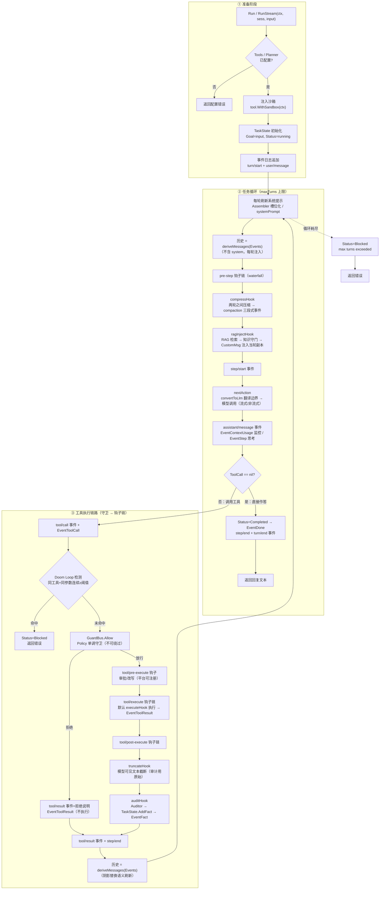

# MoS Agent 执行流程（v2）

> 来源：`agent/react.go` 的 `ReActDriver.Run` 实现（架构 v2 §3.3-3.4）。
> 默认装配：ReActDriver + 默认钩子/守卫（压缩 → RAG → 决策 → 工具链路）。

## 流程图

## 阶段说明

### ① 准备阶段

- 校验 `Tools` / `Planner` 已配置（`RunContext` 注入），缺失直接返回错误
- 沙箱注入：`tool.WithSandbox(ctx, rt.Sandbox)`，shell 类工具从 ctx 取沙箱执行
- `TaskState` 首次运行记录 Goal、进入 running
- 事件日志追加 `turn/start` 与 `user/message`（append-only，唯一事实来源）

### ② 任务循环（maxTurns 上限，默认 10）

- 每轮刷新系统提示（`Assembler` 槽位化组装优先，否则静态 `SystemPrompt`），运行时状态随 TaskState 进度更新
- 模型输入 = `SystemMsg` + `deriveMessages(Events)`（system 不写日志、每轮注入）
- **pre-step 钩子链**（waterfall，可改写/短路）：
  - `compressHook`：两轮之间（turn≥2）压缩，写 `compaction/start → summary → end` 三段式事件（summary 携带阴影范围，可回放）；摘要取 `TaskState.Snapshot()`
  - `ragInjectHook`：按 Goal 检索，知识守门后以 `CustomMsg` 注入**当轮发送副本**（不进日志）
- 决策经 `convertToLlm` 翻译边界 → 模型调用；`assistant/message` 事件记录回复/推理/工具调用/用量；`EventContextUsage` 监控预算利用率
- 模型直接作答 → 完成（`EventDone`）；请求工具 → 进入工具链路

### ③ 工具执行链路（守卫 → 钩子链）

- Doom Loop 检测：相同工具 + 相同参数连续 ≥阈值 → 中断置 blocked
- `GuardBus.Allow`（Policy 单调守卫）执行前拦截：拒绝则 `tool/result` 回填拒绝说明（不执行、不审计）
- `tool/pre-execute`：审批/改写钩子（平台可注册，默认无）
- `tool/execute`：around dispatch 钩子链，默认 `executeHook` 实际调用 `tools.Call`（沙箱内执行）；执行后广播 `EventToolResult`
- `tool/post-execute` 钩子链：
  - `truncateHook`：对模型可见文本截断（超限携带逃生通道提示），审计仍用原始结果
  - `auditHook`：审计通过的事实写入 `TaskState` 并广播 `EventFact`
- 每个出口都写 `step/end`；完成/超限时写 `turn/end`

## 关键事件序列

`EventStep` → `EventToolCall` → `EventToolResult` → `EventFact` → … → `EventDone`

附加事件：`EventStream`（流式增量）、`EventCompacted`（压缩）、`EventContextUsage`（用量/利用率）、`EventKnowledgeGap`（RAG 知识差距）。

## 会话事件日志（durable）

| 事件 | 载荷要点 | 说明 |
| --- | --- | --- |
| `turn/start` / `turn/end` | turn, reason | 打开/关闭一轮任务 |
| `step/start` / `step/end` | turn, step | 一次模型调用 + 其工具执行 |
| `user/message` | message, source | 用户输入 |
| `assistant/chunk` | turn, delta | 流式增量（token 级回放） |
| `assistant/message` | turn, content, reasoning, tool_calls, usage | 单步完整回复 |
| `tool/call` / `tool/result` | call_id, name, args / result, text, error | 工具调用与结果（text 为模型可见截断文本） |
| `compaction/start` / `compaction/summary` / `compaction/end` | summary, shadowed_from/to | 压缩三段式（可回放，替换语义） |
