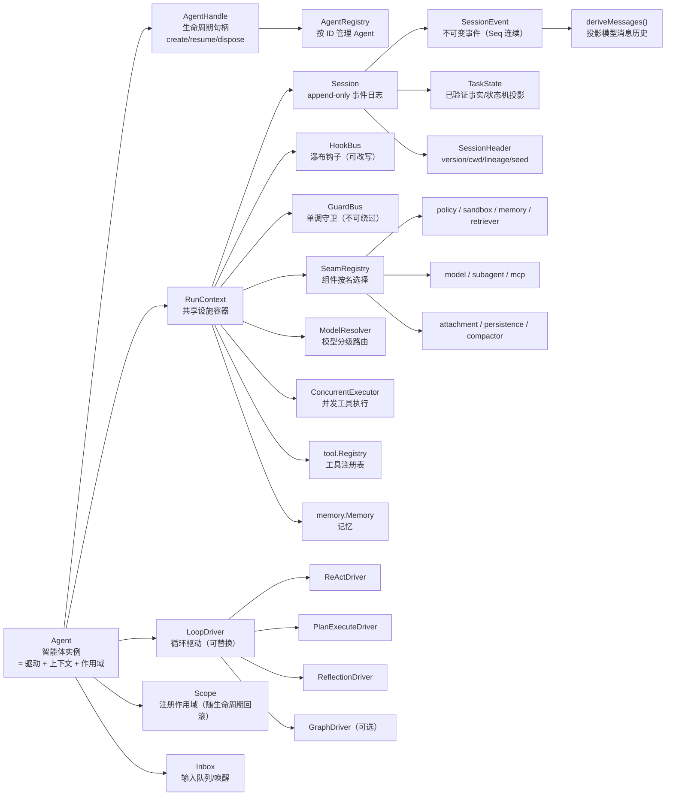

# MoS 架构演进规划（v2.3）

> 状态：设计规划（未实施）｜ 参考：DeepSeek Harness（dsh）+ Cordis 插件框架
> 目标：让 MoS 支持**多智能体循环类型（ReAct / Plan&Execute / Reflection）、环节可改写、提供者可替换、运行期装配**，采用 Go SDK 惯用法（编译期注册 + 运行期选择），不设向后兼容负担（未发布）。

## 更新记录

| 日期 | 版本 | 更新内容 |
| --- | --- | --- |
| 2026-08-16 | v2.14 | 实施：新能力 `agent/executor`（三阶段批量执行 `executor.Run`：preflight 串行决策 → 有界并发/sequential 回退 → 按源序回填，语义中立零上层依赖）；ReAct 工具路径接入批量执行（多 ToolCall 并发、拦截集合显式失败回填、`tool.SequentialTool` 整批串行回退、`RunContext.MaxToolParallel`、审计经 `AddFact` 串行化）；单调用路径统一走批量路径（N=1 特例），ToolResult 观测移至 finalize 按源序回填 |
| 2026-08-16 | v2.13 | 实施：新能力 `agent/scope`（Scope 注册作用域：按注册逆序回滚、On 返回可单独撤销 disposer、Close 幂等、关闭后注册立即执行、并发安全）+ 会话日志持久化（`agent/session.Persistence` 接口：SaveHeader/LoadHeader/Append/Load/Close，backend 可换；`JSONL` 后端：每会话一文件、首行 header、追加写、容忍尾部半行；`Session.Append` 同步落盘 fail-fast 保"日志即事实"不变式；`Restore` 重放重建 + `RepairInterrupted` 孤儿 turn 合成 interrupted，会话不存在按空会话恢复） |
| 2026-08-16 | v2.12 | 实施：新能力 `agent/seam`（SeamRegistry 组件注册表：按 kind+name 注册工厂、按名解析，工厂返回 any 消费端断言，注册表零上层依赖）+ `agent/config`（声明式配置：YAML → 按名解析组件 → assistant 装配）；assistant.Config 新增 `Driver`/`DriverFactory`/`PlanPlanner`/`Reflector` 按名选驱动；引入 yaml.v3 |
| 2026-08-16 | v2.11 | 实施：新能力 `agent/router`（DriverRouter 接口 + HybridRouter 任务路由：规则硬路由优先 → LLM 分类兜底 → fallback react）；配套 `planner.Classifier/NewClassifier`（JSON 驱动名分类 + 未知回退）；三种驱动支持裸实例惰性自装配（Run 时经 RunContext 补全默认钩子/守卫，Router 可直接返回驱动） |
| 2026-08-15 | v2.10 | 实施：新能力 `agent/driver/reflection`（Basic Reflection 驱动：Generate → Reflect → Revise 自查循环，评审通过/达最大迭代收尾）；配套 `planner.Reflector/Review/NewReflector`（JSON 评审 + 非 JSON 文本回退）、会话事件 `reflection/start|review|end`、观测事件 `EventReflection`、RunContext 新增 `Reflector` 字段（评审用独立 Context 避免自我合理化） |
| 2026-08-15 | v2.9 | 实施：新能力 `agent/driver/planexecute`（Plan&Execute 驱动：写计划 → 逐条执行内嵌 ReActDriver → 校验交付物）；配套 `planner.Plan/PlanPlanner/NewPlan`（JSON 计划生成 + 多级解析回退）、会话事件 `plan/start|step|end`、观测事件 `EventPlan`、`session.NextTurn()`（续跑/多步骤 Turn 全局递增）、RunContext 新增 `PlanPlanner` 字段 |
| 2026-08-15 | v2.8 | 实施：Step 4 拆分 `agent/driver`（LoopDriver + RunContext + Policy + Agent，`New(rt, d)` 显式指定驱动）与 `agent/driver/react`（ReActDriver + 默认装配入口 `react.New(rt)`）；根包 `driver.go`/`react.go` 删除；跨包方法导出 `Notify`/`AssembleSystem`/`MonitorUsage`；循环集成测试随迁 react 包，根包仅保留纯单测 |
| 2026-08-15 | v2.7 | 实施：Step 3 落地 `agent/hook`（HookBus + GuardBus + DoomLoopGuard/detector）；react/driver 改 `hook.*` 前缀；detector 单测随迁，doomloop 集成测试留根包 |
| 2026-08-15 | v2.6 | 实施：Step 2 落地 `agent/session`（Session 日志 + TaskState + InternalMessage + deriveMessages，含 ConvertToLlm/FormatToolResult/MessageEventSeqs 导出）；根 agent 改为 `session.*` 前缀引用；integration 型 state 测试保留在根包 |
| 2026-08-15 | v2.5 | 实施：按 §11.1 拆分 agent 包，Step 1 落地 `agent/event`（EventBus 四模式 + 会话事件目录/载荷 + MarshalData）；根包引用改为 `event.*` 前缀；§11.1 声明不设公开语义红线（开发阶段，依赖方向强制优于 API 稳定） |
| 2026-08-14 | v2.4 | 引入 PI（@earendil-works/pi-agent-core）对照：§1.3 补 PI 借鉴表；P0 落地——llm.Response.FinishReason 三协议透传、ReActDriver 截断工具调用 fail-closed（对齐 PI failToolCallsFromTruncatedMessage）、DoomLoop 迁为单调守卫（DoomLoopGuard）；§3.9 补批量执行三阶段语义、§3.10 Inbox 拆三队列、新增 §3.11 Telemetry seam（规划） |
| 2026-08-14 | v2.3 | 实施进度：MVP 核心（实施顺序 1-5）落地——EventBus 四模式、Session 事件日志（deriveMessages + 不变式）、HookBus+GuardBus、RunContext+LoopDriver+ReActDriver、assistant 默认装配；废弃命令式 run 与 WithXxx 选项；SDK 契约文档 §3 同步为事件日志格式 |
| 2026-08-14 | v2.3 | 清理：移除死代码（fromLlm、Session.LastSeq、planner.WithInstruction）与零引用包 memory/inmemory；术语表状态同步为已实现/规划中 |
| 2026-08-14 | v2.2 | 新增第 12 章：概念与名词术语表（按模块分组，标注现有/规划状态） |
| 2026-08-14 | v2.1 | 整合既有路线图（M2.8~M5）映射；DSH 全面复核；新增事件域分层（3.10）、Agent 生命周期（3.8）、并发执行语义（3.9）、Session fork lineage、Guards 与 Hooks 分离、Inbox；补充持久化/压缩/审批 seam 语义（10.3）；新增模块划分与实体定义（11） |
| 2026-08-14 | v2.0 | 初版：LoopDriver/HookBus/Session 事件日志/SeamRegistry/DriverRouter/一次性重构方案；后调整为不设兼容红线、旧实现直接废弃 |

> 约定：此后每次修订本文件，须在更新记录顶部追加一行（日期/版本/内容摘要）。

## 1. 目标与边界

### 1.1 目标

- **循环可替换**：ReAct / Plan&Execute / Reflection 等作为 `LoopDriver` 实现，按任务路由切换
- **环节可改写**：模型输入（pre-step）、请求配置（request）、工具执行（tool/pre-post）均可被钩子改写/拒绝
- **提供者可替换**：Sandbox / Memory / Retriever / Policy 等按名注册，从配置选择（对齐 dsh Capability Seam）
- **会话可重放**：append-only 会话事件日志，消息历史从日志派生（对齐 dsh Session Log）
- **运行期装配**：声明式配置（YAML）→ Agent，平台可从配置组装（对齐 dsh Profile/Bundle）

### 1.2 边界（MoS 是 SDK，不越界）

- **不做** Cordis 式运行期插件热加载/卸载/依赖注入容器——Go 无反射 DI 生态，平台需要的是"装配时选组件"而非"运行中换插件"
- **不做** 产品层（Web UI / API 网关 / 任务调度 / 多租户）——SaaS 平台负责（见 `docs/sdk-contracts.md`）
- **未发布、无外部兼容负担**：公开 API 与数据结构可自由演进，直接按目标架构落地，不设兼容层
- **旧实现直接废弃**：`Session.History` 快照、命令式 `run`、`WithXxx` 选项等将被新机制替代的实现，一次性废弃删除，不留双轨过渡代码

### 1.3 借鉴与不借鉴（对照 dsh）

| 机制 | 借鉴 | 落地形态（Go） |
| --- | --- | --- |
| Cordis 插件树 + ctx 服务仓库 | ✅ 概念 | `SeamRegistry`（组件注册表，编译期注册/运行期选择） |
| 事件四模式（emit/waterfall/parallel/serial） | ✅ | `EventBus`（Go 实现四种调度） |
| 瀑布可改写（pre-step/request/tools/*） | ✅ | `HookBus`（waterfall 语义：next 委托、可短路、可替换） |
| Session append-only 事件日志 | ✅ | `Session.Events` + `deriveMessages` 投影 |
| Scope（per-agent 注册作用域 + 自动卸载） | ✅ | `Scope`（注册回收） |
| driver 是插件（循环可替换） | ✅ | `LoopDriver` 接口 |
| Profile/Bundle 配置装配 | ✅ | 声明式配置加载器（实施顺序 7） |
| 运行期插件加载/卸载/DI | ❌ | 不实现（Go SDK 场景收益为负） |
| 事件声明合并（TS declaration merging） | ⚠️ | Go 用事件名 + payload + typed helper 近似 |
| PI `transformContext → convertToLlm` 双层消息管道 | ✅ | `HookPreStep`（pre-step 瀑布，压缩/RAG/注入）+ `convertToLlm` 翻译边界 |
| PI `beforeToolCall` block/reason/terminate | ✅ 概念 | `tool/pre-execute` 守卫 + 审批（单调、不可绕过） |
| PI `afterToolCall` 字段级合并覆盖（content/details/isError/usage/terminate） | ✅ | `tool/post-execute` 瀑布（截断/审计，结果可改写） |
| PI `prepareNextTurn`（跨轮换模型/思考级别） | ✅ | `ModelResolver` + `HookRequest`（模型分级路由，M4） |
| PI `failToolCallsFromTruncatedMessage`（截断显式失败） | ✅ 已落地 | `llm.Response.FinishReason` + ReActDriver 截断 fail-closed（见 3.3） |
| PI 批量工具执行三阶段（preflight → 并发执行 → 按序回填）+ per-tool sequential | ✅ 已落地 | `agent/executor.Run` + ReAct 批量路径（见 3.9） |
| PI `TelemetryContext/TelemetrySpan` 显式契约 + no-op + conformance tests | ✅ | `telemetry` seam（见 3.11，规划） |
| PI 动态凭据 `getApiKey`（短期 OAuth 刷新） | ✅ | `CredentialResolver` seam（见 11，规划） |
| PI `SuspendedOperation`（deferred 挂起 + missing 资源校验） | ✅ | approval 异步化 + 会话恢复资源校验（见 3.4/3.8，规划） |
| PI steer/followUp/nextRun 三队列 + QueueMode | ✅ | `Inbox` 三队列（见 3.10，规划） |
| PI `pi-protocol` 权威快照 vs transient 事件原则 | ✅ 原则 | 写入 `docs/sdk-contracts.md`（平台渲染约束） |
| PI 手动驱动（peekAction/executeAction，drive manual） | ⚠️ | 预留 driver action 事件抽象（见 5.2，可选） |

## 2. 总体架构（分层）

```text
┌─────────────────────────────────────────────────────────┐
│ 装配层：声明式配置加载器 / SeamRegistry / DriverRouter     │  实施 7-8
├─────────────────────────────────────────────────────────┤
│ 循环层：LoopDriver（ReAct / Plan&Execute / Reflection）   │  实施 4-6
│         内部经 HookBus 触发可改写环节                      │
├─────────────────────────────────────────────────────────┤
│ 基础设施层：EventBus / Session 事件日志 / RunContext      │  实施 1-4
│            / Scope / Observer                             │
├─────────────────────────────────────────────────────────┤
│ 现有基础：llm / tool / planner / memory / assistant       │  不动
└─────────────────────────────────────────────────────────┘
```

依赖方向：装配层 → 循环层 → 基础设施层 → 现有基础。现有包（`llm` / `tool` / `memory`）不反向依赖新机制。

## 3. 核心机制设计

### 3.1 事件系统（`EventBus`）

对应 Cordis 四种调度模式。事件是扩展点，模式是事件的公开契约：

```go
// DispatchMode 调度模式
type DispatchMode int

const (
	ModeEmit      DispatchMode = iota // 观察：注册顺序，无返回值（观测/日志）
	ModeWaterfall                     // 包装：注册顺序，返回值传播，可短路（改写）
	ModeParallel                      // 扇出：并发执行，无返回值（并行观测）
	ModeSerial                        // 裁决：注册顺序，短路即停（策略决策）
)

type EventBus struct{ /* name → []listener */ }

func (b *EventBus) On(name string, mode DispatchMode, h Handler)
func (b *EventBus) Emit(ctx context.Context, name string, payload any) error
func (b *EventBus) Waterfall(ctx context.Context, name string, payload any) (any, error)
func (b *EventBus) Serial(ctx context.Context, name string, payload any) (bool, error)
func (b *EventBus) Parallel(ctx context.Context, name string, payload any) error
```

类型安全：事件 payload 用 `any` + 每个事件一个 typed helper（如 `EmitToolCall(ctx, bus, ev)`），调用侧保持类型安全，总线侧保持简单。事件目录集中在 `agent/events.go`（对齐 dsh 的 event catalog）。

### 3.2 会话事件日志（`Session.Events`）

对齐 dsh Session Log：**append-only 事件日志是唯一事实来源，消息历史从日志派生，从不同时单独存储**。

```go
// SessionEvent 一条不可变会话事件（Seq 连续，持久化可原样落库）
type SessionEvent struct {
	Seq  int64           `json:"seq"`
	Type string          `json:"type"` // turn/start, step/start, user/message,
	Data json.RawMessage `json:"data"` // assistant/chunk, assistant/message,
}                                       // tool/call, tool/result, step/end, turn/end

type Session struct {
	ID     string
	Events []SessionEvent  // append-only（替代 History 成为事实来源）
	State  TaskState       // 投影：从事件重建（已验证事实/状态机）
	Header SessionHeader   // 元数据（与事件日志分离，对齐 dsh SessionHeader）
}

// SessionHeader 存储元数据：format version / cwd / lineage（fork 父会话）/ seed 边界。
// 不进事件日志、不进 deriveMessages——是存储关注点，不是会话事件。
type SessionHeader struct {
	Version  int    `json:"version"`            // 日志格式版本
	CWD      string `json:"cwd,omitempty"`      // 工作目录
	ParentID string `json:"parent_id,omitempty"` // fork lineage：父会话 ID（SubAgent 关联）
	SeedSeq  int64  `json:"seed_seq,omitempty"`  // seed 边界：fork 时复制的日志序号
}

// deriveMessages 从日志投影出模型消息历史（每次请求前调用）
func deriveMessages(events []SessionEvent) []InternalMessage
```

关键语义（对齐 dsh "Model-visible means logged"）：
- 任何进入模型请求的消息必须能从 `Events` 重建——运行时不变式，补 invariant 测试
- 压缩 = 三段式事件 `compaction/start → compaction/summary → compaction/end`（带锁与阴影范围，可回放）；摘要经 `user/message` + 替换语义进入模型面
- 恢复/回放/分叉 = 重放事件流重新投影（`Session.Save` 变为日志序列化，`RestoreSession` 变为日志重放）
- fork（SubAgent/分叉）= 新 Session 携带 `Header.ParentID` + `SeedSeq`（复制到 seed 边界），子日志独立追加
- `Session.History` 字段**废弃删除**（一次性重构，不留双轨，见 5.1）

**投影单元（Projection，规划）**（对齐 dsh session-projection）：日志之上的派生状态统一为可注册的投影单元——
`deriveMessages`（模型面）、`TaskState`（任务状态）是首批投影，stats / title 等按需注册，投影可缓存（dsh
projection-cache）、可独立失效。当前 `TaskState` 直接挂载在 `Session.State` 上，演进为按需注册的投影后保持
JSON 契约不变（见 11.4）。

### 3.3 循环层（`LoopDriver` + `RunContext`）

一种智能体类型 = 一个 `LoopDriver` 实现。默认 `ReActDriver` 是现有 `run` 的搬移，行为不变。

```go
type LoopDriver interface {
	Run(ctx context.Context, rt *RunContext, input string) (string, error)
}

type RunContext struct {
	Session   *Session
	Tools     *tool.Registry
	Memory    memory.Memory
	Policy    Policy
	Auditor   Auditor
	Sandbox   *tool.Sandbox
	Observer  Observer
	Assembler SystemAssembler
	Retriever memory.Retriever
	Hooks     *HookBus
	Guards    *GuardBus // 单调守卫（不可被钩子改写绕过，见 3.4）
	Model     ModelResolver // 请求级模型解析（模型分级路由）
	Registry  *SeamRegistry // 组件注册表（Seam 解析）
	Scope     *Scope       // 本 Agent 的注册作用域（生命周期绑定）
	Executor  *ConcurrentExecutor // 并发工具执行器（并行分支/批量调用）
	MaxTurns  int                 // 可选保险丝（>0 生效）；0 表示不限制
	ShouldStopAfterTurn func(...) // 每轮外部停止裁决（对齐 PI shouldStopAfterTurn）
}

// ModelResolver 按请求解析模型（对齐 llm 装饰器链 + Seam 按名选模型）。
type ModelResolver interface {
	Resolve(ctx context.Context, req *llm.Request, tier string) (llm.ChatModel, error)
}
```

内置驱动：
- **ReActDriver**：现有循环重写（实施顺序 4）
- **PlanExecuteDriver**：写计划 → 逐条执行（内嵌 ReActDriver 作为执行器）→ 校验交付物
- **ReflectionDriver**：Generate → Reflect → Revise 自查循环（可选，实施顺序 6）
- **GraphDriver**：节点/边/状态 schema 驱动（Graph Engineering，M3；可选变体）

### 3.4 瀑布钩子（`HookBus`）

对应 Cordis waterfall：监听器收到 `(payload, next)`，`next()` 委托下游（可改写），不调用则短路（拒绝/裁决）。

**Guards（单调守卫）与 Hooks 分离**（对齐 dsh 工具管道的 "monotonic guards"）：Policy / 权限 / 身份校验是不可重排、不可被改写的守卫——若它们作为普通 hook，平台自定义 hook 可能在守卫前改写参数绕过策略。因此：

```go
// GuardBus：串行裁决，短路即拒；守卫不可被 hook 改写绕过
type GuardBus struct{ /* ordered guards */ }
func (b *GuardBus) Add(g Guard)           // Add 追加在守卫链末尾
func (b *GuardBus) Allow(ctx, ev) error   // 任一守卫拒绝即拒绝

// HookBus：瀑布，可改写/委托
type HookBus struct{ /* ordered hooks */ }
```

`tool/pre-execute` 的顺序固定为：**guards（策略/权限，单调）→ approval（人工确认）→ hooks（改写/观测）**。

```go
type Next func(ctx context.Context, payload *Event) (*Event, error)
type Hook func(ctx context.Context, payload *Event, next Next) (*Event, error)

type HookKind string

const (
	HookPreStep         HookKind = "pre-step"          // 改写模型输入（压缩/RAG/注入）
	HookRequest         HookKind = "request"           // 改写请求配置（temperature/max_tokens）
	HookToolPreExecute  HookKind = "tool/pre-execute"  // 拒绝/改写工具调用（Policy/审批）
	HookToolExecute     HookKind = "tool/execute"      // around dispatch（超时/重试/指标）
	HookToolPostExecute HookKind = "tool/post-execute" // 改写结果/审计
	HookTurnStopping    HookKind = "turn-stopping"     // 终止判定（串行，无 next）
)

type Event struct {
	Kind     HookKind
	Messages []InternalMessage // pre-step
	Req      *llm.Request      // request
	ToolCall *llm.ToolCall     // tool/pre-execute
	Result   any               // tool/post-execute
	Turn     int
	Step     int
}
```

默认装配（行为与现状等价）：`compressHook` + `ragInjectHook` 注册在 pre-step，`policyGuard` + `DoomLoopGuard`
注册在 tool/pre-execute 守卫链，`truncateHook` + `auditHook` 在 tool/post-execute，`doneCheck` 在 turn-stopping。
平台可追加/替换。

**守卫家族化（已落地 DoomLoop）**：策略类判定（Doom Loop 检测、per-call 超时策略、重复调用提醒）统一以单调
守卫注册进 `GuardBus`，而非硬编码在 driver 主循环（对齐 dsh guard/ 家族）。`DoomLoopGuard` 已实现
（`agent/doomloop.go`）：相同工具连续相同参数调用达阈值时返回 `*DoomLoopError`（致命守卫错误，循环层终止任务并置
状态 blocked），与 Policy 同级、不可被 hook 改写绕过。超时/重试保持 `tool/execute` 钩子链职责（around
dispatch，见 §4.3），不迁入守卫。

**截断 fail-closed（已落地，对齐 PI failToolCallsFromTruncatedMessage）**：模型输出被截断
（`FinishReason` ∈ length / max_tokens）时，已产出的工具调用可能不完整——循环层不执行、逐个显式失败回填
（`tool/result` 错误事件），模型下一轮看到失败原因后调整，杜绝"已声明调用但模型面无回填"的静默丢弃。

**Approval（人工确认）one-shot 语义**（对齐 dsh `ctx.approval`）：确认是**一次性**的（allowed-once，同一确认不重复生效）；确认通道不可用或未回答时**默认拒绝**（fail-closed）。`approval/request` 发起 → `approval/resolve` 回填（one-shot 标记）→ 守卫放行一次。

### 3.5 组件注册表（`SeamRegistry`）

对齐 dsh Capability Seam 三角色（服务定义 = 现有接口；提供者 = 注册；消费者 = 按名解析）：

```go
type SeamRegistry struct {
	drivers      map[string]DriverFactory
	policies     map[string]PolicyFactory
	sandboxes    map[string]SandboxFactory
	memories     map[string]MemoryFactory
	retrievers   map[string]RetrieverFactory
	models       map[string]ModelFactory      // 模型分级路由
	subagents    map[string]SubAgentFactory   // SubAgent 执行后端（子代理 seam）
	mcps         map[string]MCPFactory        // MCP 服务器接入
	attachments  map[string]AttachmentFactory // 二进制附件存储（文件上传）
	persistence  map[string]PersistenceFactory // 会话日志持久化（jsonl/sqlite）
	compactors   map[string]CompactorFactory   // 压缩能力（能力 seam，Provider 可换）
}

// 使用：assistant.Config 支持按名
cfg := assistant.Config{
	Driver:  "plan-execute",
	Sandbox: "docker",   // SeamRegistry 解析
	Memory:  "postgres",
	Model:   "fast/slow", // 分级路由：按任务复杂度选档
	Persistence: "sqlite", // 会话日志持久化后端
}
```

每个 seam 遵循 dsh 三角色：**服务定义**（接口，已有或新增）→ **提供者**（注册）→ **消费者**（按名解析）。持久化 seam 细节见 3.8（crash 恢复/批量落盘语义）。

### 3.6 任务路由（`DriverRouter`）

```go
type DriverRouter interface {
	Select(ctx context.Context, input string, sess *Session) (LoopDriver, error)
}

// HybridRouter：规则（确定性/可审计）优先，LLM 处理模糊输入
// 简单任务 → ReAct；多步/交付物明确 → Plan&Execute；"先规划"等显式指令 → 规则硬路由
```

### 3.7 作用域（`Scope`）

per-agent/per-session 注册作用域：注册到作用域的钩子/工具/覆盖，在 agent 生命周期结束时自动回滚（对齐 Cordis "registrations are reversible effects"）。

```go
type Scope struct{ /* registrations with disposers */ }
func (s *Scope) On(kind HookKind, h Hook) func() // 返回 disposer
func (s *Scope) Close()                          // 按注册逆序回滚
```

### 3.8 Agent 生命周期（`AgentRegistry` + `AgentHandle`）

对齐 dsh `AgentHandle`（create/resume/dispose）。`Scope` 绑定到句柄生命周期，agent 销毁时注册全部回滚：

```go
type AgentHandle struct {
	Agent   *Agent
	Session *Session
	Scope   *Scope
}

type AgentRegistry struct{ /* id → *AgentHandle */ }

func (r *AgentRegistry) Create(ctx context.Context, opts CreateOptions) (*AgentHandle, error)
func (r *AgentRegistry) Resume(ctx context.Context, sessionID string, opts ResumeOptions) (*AgentHandle, error)
func (r *AgentRegistry) Get(id string) (*AgentHandle, bool)
func (h *AgentHandle) Dispose(ctx context.Context) error // 停循环 → 注销 → 回滚 Scope
```

生命周期事件（agent 域，见 3.10）：`agent/created` / `agent/status` / `agent/error` / `agent/disposed`。

### 3.9 并发执行语义（并行工具 / 日志串行化）

整合后 LLMCompiler 并行分支、AgentTeam 多 Agent、批量工具执行要求并发工具调用。原"单 Session 单 Run 串行"需扩展。
执行语义对齐 PI `executeToolCallsParallel` 的三阶段模型：

1. **prepare（preflight，串行）**：参数校验 + 守卫决策（beforeToolCall 语义：block/reason/terminate），
   生成"允许执行"与"拦截（显式失败回填）"两个集合；
2. **execute（并发）**：允许集合有界并发执行；任一工具声明 `sequential` 时整批回退串行
   （per-tool 模式覆盖全局模式，对齐 PI `ToolExecutionMode`）；
3. **finalize（回填）**：`tool/execution` 观测事件按完成顺序广播，`tool/result` 模型面消息按 assistant
   source order 回填（日志串行化，Seq 连续）；批量早停规则 = 所有已终结结果均请求终止时才提前结束
   （对齐 PI `shouldTerminateToolBatch`）。

```go
// agent/executor（语义中立，零上层依赖；Go 方法不支持类型参数，故为包级泛型函数）
func Run[T, R any](ctx context.Context, items []Item[T], maxParallel int,
	preflight Preflight[T], execute Execute[T, R]) []Outcome[T, R]
```

落地形态（✅ 已实现）：`agent/executor.Run` 提供三阶段编排；ReAct 驱动的工具调用路径
（`react.execBatchTools`）接入：preflight = `tool/call` 落日志 + 单调守卫决策（拒绝 = 拦截集合），
execute = pre-execute → execute → post-execute 钩子链有界并发（`RunContext.MaxToolParallel`，
任一工具实现 `tool.SequentialTool` 时整批回退串行），finalize = `tool/result` 按模型调用顺序回填
（日志 Seq 连续 + `EventToolResult` 观测按源序）。审计事实写入经 `RunContext.AddFact` 串行化
（并发 goroutine 写同一 `Session.State`）。

语义约束：
- **日志串行化**：并行工具的事件（`tool/call` / `tool/result`）经 Executor 串行追加，Seq 连续、顺序可重放
- **截断显式失败**：响应被截断（length/max_tokens）时整批工具调用不执行、逐个失败回填（已落地单调用路径，
  批量路径同一语义）
- **有界并发**：`maxParallel` 上限 + 取消传播（ctx 取消 → 并行批次整体取消）
- **汇聚语义**：分支结果合并由 driver 负责（Map-Reduce 汇聚 / 摘要合并）
- **模型顺序回填**：即使工具并行执行，`tool/result` 按模型调用顺序回填，保持模型可见序列稳定

（日志串行化通过 finalize 单 goroutine 按源序回填实现，无需持锁写日志；观测事件 `EventFact`
由审计在各自执行 goroutine 内按完成序广播，`EventToolResult` 在 finalize 按源序广播。）

### 3.10 事件域分层（session / agent / capability）+ Inbox

对齐 dsh 三域事件，v2 事件分三类：

| 域 | 语义 | 示例 |
| --- | --- | --- |
| **会话域**（durable） | append-only 日志，可重放/恢复 | `turn/start`、`user/message`、`tool/result`、`compaction/summary` |
| **Agent 域**（live） | Agent 生命周期与编排观测/拦截 | `agent/created`、`agent/status`、`agent/error`、`subagent/start`、`agent/inbox` |
| **能力域**（seam） | 能力提供者的策略/适配挂载 | `fs/*`、`approval/*`、`tools/*` 钩子 |

**Inbox（输入队列/唤醒，三队列规划）**（对齐 dsh inbox + PI steer/followUp/nextRun）：Agent 持有多输入队列——
异步消息先进队列，队列非空唤醒 driver 处理；`user/message` 事件记录每次 claim。这支撑 SaaS 异步交互与
AgentTeam 通信：

```go
type Inbox struct{ /* 三队列 */ }
func (b *Inbox) Steer(m InternalMessage) error     // 运行中转向消息（当前轮结束后注入）
func (b *Inbox) FollowUp(m InternalMessage) error  // 结束后跟进消息（agent 空闲后处理）
func (b *Inbox) NextRun(m InternalMessage) error   // 下次运行预置消息（prompt 前的初始输入）
func (b *Inbox) Drain(mode QueueMode) []InternalMessage // all：全部排空 / one-at-a-time：每次一条
```

队列语义（对齐 PI `QueueMode`）：`steer` 在当前轮工具执行完、下一轮开始前注入；`followUp` 在 agent 即将停止时
注入续跑；`nextRun` 作为下次 Run 的初始输入。`one-at-a-time` 模式每次只注入最旧一条，其余留待后续排空点，
避免大批量消息一次性冲垮上下文。

### 3.11 Telemetry seam（规划，对齐 PI pi-telemetry）

MoS 现有 `Observer`（单层回调）+ `EventBus` emit 只覆盖"应用内观测"；平台可观测性（SaaS 指标/追踪）需要
**显式传递的 span 契约**（对齐 PI：无全局 current-span、无 exporter 依赖、适配器由平台注入）：

```go
// telemetry 包（规划）：契约 + no-op + 参考实现
type TelemetryContext interface {
	StartSpan(ctx context.Context, name string, attrs map[string]string) (TelemetrySpan, context.Context)
}
type TelemetrySpan interface {
	SetAttribute(k, v string)
	AddEvent(name string, attrs map[string]string)
	End(err error)
}

var NoopTelemetry = ...
```

- `RunContext.Telemetry`（可选，nil 时内部降级 no-op）：llm 请求、工具执行、driver 回合自动打 span
  （携带 provider / model / tool / turn 属性），`Observer`/会话事件投影为 span 事件
- 平台提供适配器（OpenTelemetry / 自研），并复用"实现者 conformance 测试"模式验证适配正确性（对齐 PI）
- 与"权威快照 vs transient 事件"原则配合：span 是诊断数据，不参与会话权威状态还原

## 4. 事件目录（草案）

### 4.1 会话事件（durable，append-only 日志）

| 事件 | 载荷 | 说明 |
| --- | --- | --- |
| `turn/start` / `turn/end` | turn, reason | 打开/关闭一轮任务 |
| `step/start` / `step/end` | turn, step | 一次模型调用 + 其工具执行 |
| `user/message` | message, source | 用户输入 / inject 注入 / 目标延续 |
| `assistant/chunk` | chunk | 流式增量（token 级回放保真） |
| `assistant/message` | message, usage | 单步完整回复 + 用量 |
| `tool/call` / `tool/result` | callId, name, args / result | 工具调用与结果 |
| `compaction/start` / `compaction/summary` / `compaction/end` | lock, summary, shadowed range/seqs | 压缩三段式（带锁 + 阴影范围，可回放；summary 经 user/message 替换进模型面） |

### 4.2 Agent 域事件（live，编排与生命周期）

| 事件 | 模式 | 职责 |
| --- | --- | --- |
| `agent/created` / `agent/disposed` | emit | Agent 创建/销毁（AgentRegistry 生命周期） |
| `agent/status` | emit | running / idle / blocked 状态迁移 |
| `agent/error` | emit | 运行期错误（持久化写失败等） |
| `agent/inbox` | emit | 输入入队/claim（Inbox 观测） |
| `subagent/start` / `subagent/end` | emit | SubAgent 生命周期观测 |
| `agent/request-error` | waterfall | 模型请求失败：检测→处理→恢复（M4 异常处理） |
| `approval/request` / `approval/resolve` | serial / emit | 人工确认发起与回填（one-shot，默认拒绝） |

### 4.3 运行期钩子（live，waterfall/serial）

| 钩子 | 模式 | 职责 |
| --- | --- | --- |
| `pre-step` | waterfall | 改写模型输入（压缩/RAG/inject） |
| `before_payload`（规划，对齐 PI before_request） | waterfall | 发请求前最终载荷改写（工具 schema 裁剪、动态凭据注入） |
| `request` | waterfall | 改写请求配置（temperature/max_tokens/模型分级） |
| `after_response`（规划，对齐 PI after_response） | waterfall | 响应落地前改写（截断检测、结果规范化） |
| `before_compaction`（规划，对齐 PI before_compaction） | waterfall | 压缩前干预（跳过/自定义指令） |
| `tool/pre-execute` | serial | 策略/审批（拒绝短路） |
| `tool/execute` | waterfall | around dispatch（超时/重试/指标） |
| `tool/post-execute` | waterfall | 改写结果/审计 |
| `turn-stopping` | serial | 终止判定 |

### 4.4 观测事件（emit，兼容现有 Observer）

现有 `EventStep` / `EventToolCall` / `EventToolResult` / `EventFact` / `EventDone` / `EventStream` / `EventCompacted` / `EventContextUsage` / `EventKnowledgeGap` 保留，挂到会话事件/钩子的 emit 投影上，`Observer` API 不变。

## 5. 实施方式：一次性重构

> 原则：**不渐进、不双轨**。旧实现（`Session.History` 快照、命令式 `run`、`WithXxx` 选项、`Observer` 单层回调）一次性废弃删除，按目标架构重写；测试保留意图并整体重写适配新 API。旧实现保留在 git 历史中，可随时回滚对照。

### 5.1 废弃清单

| 旧实现 | 替代 |
| --- | --- |
| `Session.History []InternalMessage`（快照） | `Session.Events []SessionEvent`（append-only 日志）+ `deriveMessages` 投影 |
| `Session.Save` / `RestoreSession`（快照 JSON） | 日志序列化 / 日志重放（格式重设计） |
| 命令式 `run` 循环（步骤写死） | `LoopDriver` 接口 + `ReActDriver` 实现 |
| `WithPolicy` / `WithCompactor` / `WithRetriever` 等选项（设字段） | `HookBus` 钩子注册（`On(HookPreStep, ...)` 等） |
| `Observer func(Event)` 单层回调 | 观测事件（emit 投影）+ 会话事件（durable），Observer 保留为观测便捷入口 |
| `planner.Planner` 单步决策接口 | 保留（作为 `ReActDriver` 内部决策器）；循环结构由 `LoopDriver` 负责 |

### 5.2 实施顺序（模块依赖顺序，非时间阶段）

按依赖顺序逐模块落地，每模块完成即测试全绿；**不存在新旧并存期**：

1. **`EventBus`**（四模式调度 + 事件目录）——✅ 已落地
2. **`Session.Events` 日志**（append-only + `deriveMessages` + 不变式测试）——删除 `History`——✅ 已落地
3. **`HookBus`**（瀑布钩子 + `Event` 载荷）——✅ 已落地（含 GuardBus 单调守卫）
4. **`RunContext` + `LoopDriver` + `ReActDriver`**（重写循环，删除命令式 `run`）——✅ 已落地
   （含 P0 增强：截断工具调用 fail-closed + `DoomLoopGuard` 守卫化）
5. **`assistant` 组装层重写**（默认装配 = ReActDriver + 默认钩子注册；删除 `WithXxx` 选项）——✅ 已落地
6. **`ConcurrentExecutor`**（批量工具三阶段：preflight → 并发执行 → 按序回填，见 3.9）——✅ 已落地
7. **`PlanExecuteDriver` + `ReflectionDriver` + `DriverRouter`**（新能力）——规划中
8. **`SeamRegistry` + 声明式配置加载器**（新能力，平台装配入口）——规划中
9. **`Scope` + 会话日志持久化后端接口**（新能力）——✅ 已落地
10. **`telemetry` seam**（span 契约 + no-op + 适配器，见 3.11）——规划中（P0，平台集成前置）

### 5.3 验收

- 每模块完成后 `go test ./...` 全绿（测试按新 API 重写，保留原意图）
- 重构完成时：废弃清单中所有旧符号从公开 API 消失，`go vet` / `gofmt` 干净
- 新能力（Plan&Execute / 钩子改写 / 配置装配）有独立集成测试

## 6. 演进约束

项目未发布、无外部使用者，**公开 API 与数据结构可自由变更**，不设兼容层。仅保留一条约束：

- **分层依赖**：`llm` / `tool` / `memory` 保持基础层，不反向依赖新机制（`EventBus` / `LoopDriver` / `HookBus` 只在上层），防止包依赖环

其余（API 命名、数据结构、`Save/Restore` 格式、选项签名）全部按目标架构直接落地，不做过渡兼容。

## 7. 风险与对策

| 风险 | 对策 |
| --- | --- |
| 一次性重构改动面大、回归风险集中 | 旧实现保留在 git 历史，可回滚对照；测试保留原意图整体重写；先跑旧版关键场景留 golden 输出 |
| 重写过程丢失旧边界行为 | 重构前用现有测试覆盖的场景做输出快照（golden），重写后对比 |
| Go 泛型事件总线复杂度 | 事件目录集中管理 + typed helper；不追求完全类型化总线 |
| Plan&Execute 与 ReAct 行为差异 | 共享 `RunContext`/工具/审计；执行器复用 ReActDriver |
| 过度设计（平台暂无需求） | 实施顺序 6-8 项按需启用；1-5 项是核心 |

## 8. 与 DSH 的最终差距（完成实施后）

| 维度 | 状态 |
| --- | --- |
| 循环可替换 / 环节可改写 / 提供者可换 | ✅ 拉平 |
| 会话事件日志（重放/恢复） | ✅ 拉平（含分叉能力的基础） |
| 事件域分层（durable/live） | ✅ 拉平 |
| Scope 注册回收 | ✅ 拉平 |
| 运行期插件热加载 / DI 容器 | ❌ 不实现（定位差异，Go SDK 场景收益为负） |
| 产品面（UI/网关/调度/生态） | ⚪ 定位差异（SaaS 平台负责） |

完成本规划后，MoS 在"可扩展架构"上与 DSH 差距约 5-10%，集中在 Cordis 专属的运行期动态装配；产品面差距由定位决定，不属于架构差距。

## 9. 既有路线图的整合映射

README 路线图中未实现的里程碑（M2.8 ~ M5）按三类归位：**v2 架构承载**（成为本规划的一部分）、**正交能力**（与架构无关，可并行推进）、**平台层**（SaaS 平台负责，SDK 只提供原语）。

### 9.1 v2 架构承载（并入本规划）

| 路线图项 | 承载机制 |
| --- | --- |
| M2.8 `request_human_input` 工具 + 升级策略 | 普通工具 + `tool/pre-execute` 的 **approval 环节**（对齐 dsh `ctx.approval`：钩子发起确认 → 异步回填 → 放行/拒绝） |
| M2.8 Checkpointer（interrupt-before 断点） | `Session.Events` 日志持久化（实施顺序 8）：事件可落库，恢复 = 日志重放 |
| M3 Coordinator 路由 | `DriverRouter`（规则 + LLM 混合路由，已设计） |
| M3 双阶段 Plan&Solve | `PlanExecuteDriver`（实施顺序 6） |
| M3 Basic Reflection | `ReflectionDriver`（实施顺序 6） |
| M3 SubAgent（agents-as-tools） | SubAgent 实现 `tool.Tool`，内部是独立 `Agent`（自持 `RunContext`/Scope）；主 Agent 经 function calling 调用，回传仍须审计 |
| M3 Agent Loop 升级（批量工具执行、错误注入） | `LoopDriver` 支持批量 tool/call 事件；`request-error` 钩子回填"为何失败 + 正确做法" |
| M3 合约化任务 / Elo 择优 / LLMCompiler | 分别挂 `pre-step`（合约注入）/ `request`（多方案生成）/ 图驱动 LoopDriver 变体 |
| M3 MCP 接入 | MCP 服务器适配为 `tool.Tool`（stdio/streamable-http 传输），注册进工具表 |
| M3 Graph Engineering | 可设计为一种 `LoopDriver` 变体（节点/边/状态 + checkpointer），仅在满足分支/并行/持久/可审计判据时引入 |
| M4 异常处理与恢复 | **`request-error` 瀑布钩子**（新增事件目录项）：检测（工具输出验证/API 错误码/超时）→ 处理（重试/回退/降级）→ 恢复（诊断/升级到人工） |
| M4 沙箱强隔离（Docker/containerd） | `SeamRegistry` 的 sandbox provider（`Sandbox: "docker"`），`tool.Sandbox` 接口不变 |
| M4 模型分级路由 | llm 装饰器链（`WithFallback`/`WithRetry` 已有）+ `SeamRegistry` 按名选模型 |
| M4 `runs/<run-id>` 可恢复运行目录 | `Session.Events` 日志持久化 + 工作目录约定（实施顺序 8） |
| M4 生命周期控制 API（启动/暂停/恢复/终止） | SDK 侧：`AgentHandle`（create/resume/dispose，对齐 dsh AgentHandle）；HTTP 暴露归平台层 |
| M4 评估与监控 | `Session.Events`（durable 轨迹）+ 事件流输出到外部评估系统；Golden 测试集 + LLM-as-Judge 为独立工具 |
| M5 自我进化（消费审计事件流） | 独立子系统订阅 v2 durable 会话事件；核心引擎人类控制（平台层/实验性） |

### 9.2 正交能力（与架构无关，可并行）

| 路线图项 | 说明 |
| --- | --- |
| M2.9 经验记忆 | 提供 `Retriever` 实现（原 `memory/longterm` 已移除），经 `pre-step` 注入钩子复用，不依赖本规划 |
| M2.10 工具规模化（schema 压缩/懒加载/保 cache） | `tool` 与 `SystemAssembler` 的优化，schema 缓存已落地；与循环架构正交 |

### 9.3 平台层（SaaS 平台负责，SDK 仅提供原语）

| 路线图项 | SDK 提供 | 平台负责 |
| --- | --- | --- |
| M4 优先级调度 / 限流配额 | 事件/用量素材 | 队列与调度器 |
| M4 人工网关（Web 化确认） | approval 钩子（异步回填） | 弹窗/通知/回调通道 |
| M4 Dashboard / 可视化 | durable 会话事件 + 轨迹 | 存储与展示 |
| M4 熵管理（文档园丁） | — | 后台任务 |
| M4 插件化 marketplace | SKILL.md 加载（已有）+ MCP 适配 | 插件索引/安装/认证 |
| M3 AgentTeam | SubAgent 原语 | 团队状态落盘与重建（`runs/<run-id>`） |

### 9.4 路线图治理

- README 路线图逐步退役：已完成项保留历史；未实现项按上表迁移到本规划，README 保留指向本文档的链接
- 新增能力一律先落到本规划的承载机制（驱动/钩子/Seam/事件），避免"临时实现"再次游离于架构之外

## 10. 整合后的设计调整总览（v2.1）

整合既有路线图（第 9 章）并对 DSH 全面复核后，对第 3 章核心机制做了以下调整：

### 10.1 结构调整（对应第 3 章修订）

| # | 调整 | 位置 | 来源 |
| --- | --- | --- | --- |
| 1 | 事件域分层：session / agent / capability 三域 | 3.10 | DSH 三域事件 |
| 2 | Agent 生命周期原语：`AgentRegistry` + `AgentHandle` | 3.8 | DSH AgentHandle |
| 3 | 并发执行语义：并行工具/日志串行化/有界并发 | 3.9 | DSH barriers + bounded pool |
| 4 | Session fork lineage：`SessionHeader`（ParentID/SeedSeq） | 3.2 | DSH SessionHeader + fork |
| 5 | Seam 扩展：model / subagent / mcp / attachment / persistence / compactor | 3.5 | DSH capability seams |
| 6 | RunContext 扩展：ModelResolver / Guards / Executor / Scope / Registry | 3.3 | 编排需求 |
| 7 | Guards（单调守卫）与 Hooks 分离：Policy 不可被改写绕过 | 3.4 | DSH monotonic guards |
| 8 | Inbox 输入队列/唤醒 + Agent 域事件 | 3.10 / 4.2 | DSH inbox |

### 10.2 DSH 复核发现的新遗漏（已并入上述调整）

| 遗漏项 | 并入位置 |
| --- | --- |
| 压缩三段式事件（start/summary/end + 阴影范围）+ compaction 作为能力 seam | 3.2 / 4.1 / SeamRegistry |
| 持久化 seam 完整语义（flush 批处理、crash 孤儿 turn → synthetic interrupted、header 与日志分离） | 3.8 / 3.5（持久化详情见下） |
| Approval one-shot + 默认拒绝（fail-closed） | 3.4 |
| Attachment seam（二进制附件存储，文件上传的 SDK 侧抽象） | 3.5 |
| Inbox（异步输入/唤醒，SaaS 异步交互与 AgentTeam 通信） | 3.10 |
| Invariants 注册机制（request-reconstruction 等不变式断言） | 阶段 1 验收（测试级） |

### 10.3 持久化 seam 语义（对齐 dsh SessionPersistence）

- **flush checkpoint**：事件按批落盘（首个 pending 事件开启批处理窗口，`session/flush` 显式排空）；写失败保留事件、暂停自动重试、显式 flush 报告错误——规划中（当前为逐条同步落盘 fail-fast）
- **crash recovery**：重载到孤儿 `turn/start`（无 `turn/end`）**不截断**，追加合成 `turn/end{reason: interrupted}` 平衡日志——✅ 已落地（`RepairInterrupted`，按 turn 号集合求差）
- **header 分离**：format version / cwd / lineage / seed 存 `SessionHeader`，不进事件日志——✅ 已落地
- **backend 可换**：jsonl / sqlite 实现同一 `Persistence` 接口——✅ 接口已落地（jsonl 已实现，sqlite 可后续补充）

### 10.4 明确不借鉴（复核后确认）

| DSH 能力 | 不借鉴原因 |
| --- | --- |
| typert 动态类型注册表 | Go 静态类型，不需要运行期类型系统 |
| commands / feedback / user-questions / session-title / session-query | 产品/平台层 |
| credentials / identity / settings | MoGo 或平台承担（密钥/身份/设置） |
| lsp / terminal / web / acp | 产品层或生态 |
| 运行期插件热加载 / DI 容器 | Go SDK 场景收益为负（前文已述） |

### 10.5 复核结论

经全面对照 DSH 子系统（session / persistence / compaction / scope / approval / attachment / storage / subagent / sandbox / token-meter / invariants 等），v2.1 设计已覆盖 DSH 对 MoS 有借鉴价值的能力面；剩余差距为运行期动态装配（不做）与产品层（平台负责）。

### 10.6 PI 复核结论（v2.4）

经对照 PI（@earendil-works/pi-agent-core / pi-telemetry / pi-protocol），补充以下运行时语义（已并入上述调整）：

| PI 能力 | 并入位置 | 状态 |
| --- | --- | --- |
| 截断消息的 tool call 显式失败（failToolCallsFromTruncatedMessage） | 3.3 / 3.4 | ✅ 已落地 |
| 批量工具三阶段执行 + per-tool sequential + 批量早停规则 | 3.9 | 规划 |
| Guard 家族化（DoomLoop / 超时策略 / 重复提醒为独立守卫） | 3.4 | DoomLoop 已落地 |
| 钩子时机补齐（before_payload / after_response / before_compaction） | 4.3 | 规划 |
| Telemetry 显式 span 契约 + conformance tests | 3.11 | 规划 |
| Inbox 三队列（steer/followUp/nextRun）+ QueueMode | 3.10 | 规划 |
| 动态凭据解析（getApiKey，短期 OAuth 刷新） | 11.4 CredentialResolver | 规划 |
| Deferred 人工介入（approval 异步化 + 挂起恢复资源校验） | 3.4 / 3.8 | 规划 |
| 权威快照 vs transient 事件原则（协议/UI 渲染约束） | sdk-contracts | 规划 |
| 手动驱动/步进执行（peekAction/executeAction） | 5.2 预留 | 可选 |

不借鉴：PI 无内置权限系统（MoS Policy+GuardBus+Sandbox 已领先）、`pi-protocol` 传输层（SaaS 平台负责）、
evals 体系（平台/测试基建，SDK 保留接口级 conformance 测试）。

## 11. 模块划分与实体定义

### 11.1 模块划分（包结构）

  > 以下为**目标包结构**（v2 演进方向，按模块落地时逐步拆分）；当前实现为 `agent`（含已拆出的
  > `agent/event`、`agent/session`、`agent/hook`、`agent/driver`、`agent/driver/react`、
  > `agent/driver/planexecute`、`agent/driver/reflection`、`agent/seam`、`agent/router`、`agent/scope`）/
  > `assistant` / `llm` / `planner` / `tool` / `memory`（具体状态见第 12 章术语表标注）。
> 包拆分**不设公开语义红线**（开发阶段）：公开 import 路径可随拆分调整，调用点同步更新；
> 拆分的核心收益是**依赖方向由编译器强制**（基础层不得反向依赖上层机制）。

```mermaid
flowchart TD
    subgraph ASM["装配层"]
        A1["agent/config ✅<br/>声明式配置加载（YAML→Agent）"]
        A2["agent/registry<br/>AgentRegistry + AgentHandle"]
        A3["assistant<br/>组装层（默认装配）"]
        A4["agent/router ✅<br/>DriverRouter 任务路由"]
    end

    subgraph LOOP["循环层"]
        L1["agent/driver ✅<br/>LoopDriver 接口 + RunContext"]
        L2["agent/driver/react ✅<br/>ReActDriver"]
        L3["agent/driver/planexecute ✅<br/>PlanExecuteDriver"]
        L4["agent/driver/reflection ✅<br/>ReflectionDriver"]
        L5["agent/driver/graph<br/>GraphDriver（可选）"]
    end

    subgraph ORCH["编排原语"]
        O1["agent/subagent<br/>SubAgent（agents-as-tools）"]
        O2["agent/mcp<br/>MCP 适配器（→tool.Tool）"]
        O3["agent/approval<br/>人工确认（one-shot）"]
    end

    subgraph INFRA["基础设施层"]
        I1["agent/event<br/>EventBus 四模式"]
        I2["agent/session<br/>Session 日志 + deriveMessages"]
        I3["agent/hook<br/>HookBus + GuardBus"]
        I4["agent/seam ✅<br/>SeamRegistry"]
        I5["agent/scope ✅<br/>Scope 注册作用域"]
        I6["agent/inbox<br/>Inbox 输入队列"]
        I7["agent/executor ✅<br/>ConcurrentExecutor 三阶段批量执行"]
        I8["agent/telemetry<br/>Telemetry span 契约（no-op + 适配器）"]
    end

    subgraph BASE["基础层（现有，不动）"]
        B1["llm<br/>ChatModel 抽象 + 适配器"]
        B2["tool<br/>工具注册 + 内置/扩展工具"]
        B3["planner<br/>Planner 决策器"]
        B4["memory<br/>记忆接口 + Retriever 扩展点"]
    end

    ASM --> LOOP --> ORCH --> INFRA --> BASE
    ASM --> ORCH
```



依赖方向严格自上而下：装配层 → 循环层 → 编排原语 → 基础设施层 → 基础层；基础层不反向依赖任何上层机制。

### 11.2 实体与概念定义



### 11.3 核心实体清单

| 实体 | 定义 | 关键职责 |
| --- | --- | --- |
| `Agent` | 智能体实例：`RunContext` + `LoopDriver` + `Scope` + `Inbox` | 持有驱动与上下文，对外暴露 Run/生命周期 |
| `AgentHandle` | Agent 生命周期句柄（create/resume/dispose） | 所有权边界：只有持有者可销毁；销毁 = 停循环 → 注销 → 回滚 Scope |
| `RunContext` | driver 共享设施容器 | Session/工具/钩子/守卫/Seam/模型解析/并发执行器 |
| `LoopDriver` | 循环驱动接口 `Run(ctx, rt, input)` | 一种智能体类型 = 一个实现（ReAct/PlanExecute/Reflection/Graph） |
| `Session` | append-only 事件日志 + TaskState 投影 + Header | 唯一事实来源；消息历史经 `deriveMessages` 派生 |
| `SessionEvent` | 不可变事件（`Seq` 连续，`Type` + `Data`） | 持久化/回放/恢复的最小单元 |
| `SessionHeader` | 存储元数据（version/cwd/lineage/seed） | 与事件日志分离，不进模型面 |
| `TaskState` | 任务状态投影（目标/已验证事实/状态机） | 从事件重建；跨轮唯一真相 |
| `EventBus` | 事件分发器（emit/waterfall/parallel/serial） | 事件是扩展点，模式是公开契约 |
| `HookBus` | 瀑布钩子（可改写/短路/委托） | 环节可插拔：pre-step/request/tool-pre-post/turn-stopping |
| `GuardBus` | 单调守卫（串行裁决，不可被改写绕过） | Policy/权限/身份：安全防线 |
| `SeamRegistry` | 组件注册表（按名选提供者） | driver/policy/sandbox/memory/model/subagent/mcp/attachment/persistence/compactor |
| `Scope` | per-agent 注册作用域 | 注册回收：agent 销毁时按逆序回滚 |
| `Inbox` | 输入队列/唤醒 | 异步消息进入；队列非空唤醒 driver |
| `ConcurrentExecutor` | 并发工具执行器 | 并行分支 + 日志串行化 + 有界并发 + 模型顺序回填 |
| `DriverRouter` | 任务路由（规则 + LLM） | 按任务选 driver / 委派 SubAgent |
| `ModelResolver` | 请求级模型解析 | 模型分级路由（简单→经济、复杂→强） |
| `Approval` | 人工确认（one-shot） | 发起确认 → 异步回填 → 放行一次；默认拒绝 |
| `Projection` | 日志派生投影（规划） | 模型消息 / TaskState / stats / title 多投影，可注册可缓存（对齐 dsh session-projection） |
| `TelemetryContext/TelemetrySpan` | 显式遥测契约（规划） | 平台可观测性：span 树 + no-op + 适配器（对齐 PI pi-telemetry） |
| `CredentialResolver` | 请求级凭据解析（规划） | 短期 OAuth token 按请求刷新（对齐 PI getApiKey） |

### 11.4 投影单元与 CredentialResolver（规划，对齐 DSH/PI）

- **Projection**（见 3.2）：日志之上可注册多个派生投影（模型消息 / TaskState / stats / title），投影可缓存、
  可独立失效；`TaskState` 由 `Session.State` 演进为按需注册的投影，JSON 契约不变。
- **CredentialResolver**：`llm` 层请求级凭据解析 seam——适配器构造时不再绑定固定凭据，按请求
  `Resolve(ctx, provider) (apiKey, error)` 动态取用，支持短期 OAuth token 过期刷新（SaaS 平台集成前置）。

## 12. 概念与名词术语表

> 按模块分层罗列 v2 设计中的概念与名词，供快速查阅。状态标记：✅ 已实现（当前代码已落地）、🔧 已实现·待演进（已落地但后续将扩展/重构）、🧱 规划中（v2 设计，未实现）。事件与钩子全量目录见第 4 章，此处仅速查。

### 12.1 装配层（agent/config、agent/registry、agent/router、assistant）

| 概念 | 定义/职责 | 所在模块/包 | 状态 |
| --- | --- | --- | --- |
| `Agent` | 智能体实例 = `RunContext` + `LoopDriver` 组合；对外暴露 Run / RunStream（MVP 未含 Scope/Inbox） | agent/driver | ✅ 已实现 |
| `Assistant` | 默认装配层：ChatModel + 工具集 + Config → 组装好的可运行智能体 | assistant | ✅ 现有 |
| `assistant.Config` | 声明式装配配置（结构化注入）；`Driver`/`DriverFactory`/`PlanPlanner`/`Reflector` 支持按名选驱动与组件 | assistant | ✅ 已实现 |
| `AgentRegistry` | 按 ID 管理 Agent 句柄：Create/Resume/Get | agent/registry（规划） | 🧱 规划中 |
| `AgentHandle` | 生命周期句柄（create/resume/dispose）；所有权边界，销毁 = 停循环 → 注销 → 回滚 Scope | agent/registry（规划） | 🧱 规划中 |
| `CreateOptions` / `ResumeOptions` | 创建 / 恢复选项；Resume 按 sessionID 从事件日志重放 | agent/registry（规划） | 🧱 规划中 |
| `DriverRouter` / `HybridRouter` | 任务路由：规则优先（确定性/可审计）+ LLM 兜底（模糊输入），按输入选 LoopDriver；返回裸驱动实例（Run 时惰性装配） | agent/router | ✅ 已实现 |
| `Classifier` | LLM 任务分类：输出 JSON 驱动名（react / plan-execute / reflection），未知/无法解析走 fallback | planner | ✅ 已实现 |
| `SystemAssembler` | 按会话组装系统提示词（Slots：约束/任务/状态/工具） | agent | ✅ 现有 |
| `SystemSection` / `SystemSlot` | 系统提示的段落与可开关槽位 | agent | ✅ 现有 |

### 12.2 循环层（agent/driver）

| 概念 | 定义/职责 | 所在模块/包 | 状态 |
| --- | --- | --- | --- |
| `LoopDriver` | 循环驱动接口 `Run(ctx, rt, input)`；一种智能体类型 = 一个实现 | agent/driver | ✅ 已实现 |
| `RunContext` | driver 共享设施容器：Session/工具/规划器/守卫/钩子/审计/压缩/RAG/批量执行（MaxToolParallel + AddFact 串行化） | agent/driver | ✅ 已实现 |
| `Policy` | 工具调用安全策略检查点：注入 GuardBus 单调守卫，不可被 hook 改写绕过 | agent/driver | ✅ 已实现 |
| `ReActDriver` | 默认驱动：原 run 循环搬移，行为不变；默认装配钩子/守卫 | agent/driver/react | ✅ 已实现 |
| `PlanExecuteDriver` | 写计划 → 逐条执行（内嵌 ReActDriver 作执行器）→ 校验交付物；步骤失败/校验失败置 blocked | agent/driver/planexecute | ✅ 已实现 |
| `Plan` / `PlanStep` / `PlanPlanner` | 计划数据结构与生成接口：模型产出 JSON 步骤数组，多级解析回退（围栏/行拆分/单步兜底） | planner | ✅ 已实现 |
| `ReflectionDriver` | Generate → Reflect → Revise 自查循环；评审通过 / 达最大迭代收尾，失败置 blocked | agent/driver/reflection | ✅ 已实现 |
| `Reflector` / `Review` | 评审接口与结果：独立 Context 评审产出（避免自我合理化），JSON 解析 + 文本回退 | planner | ✅ 已实现 |
| `GraphDriver` | 显式状态图驱动（可选） | agent/driver/graph（规划） | 🧱 规划中 |
| `ModelResolver` | 请求级模型解析：分级路由（简单→经济、复杂→强） | agent/driver（RunContext 设施，规划） | 🧱 规划中 |

### 12.3 编排原语（agent/subagent、agent/mcp、agent/approval）

| 概念 | 定义/职责 | 所在模块/包 | 状态 |
| --- | --- | --- | --- |
| `SubAgent` | agents-as-tools：子代理作为工具被调用；Session fork lineage（ParentID + SeedSeq） | agent/subagent（规划） | 🧱 规划中 |
| `MCP` 适配器 | MCP 服务器接入，归一为 `tool.Tool` | agent/mcp（规划） | 🧱 规划中 |
| `Approval` | 人工确认 one-shot 语义：发起 → 异步回填 → 放行一次；默认拒绝（fail-closed） | agent/approval（规划） | 🧱 规划中 |
| `Confirmer` | 现有同步确认接口（CLI y/N）；v2 扩展为异步确认通道 | assistant | 🔧 现有·演进 |
| `ConfirmRequest` | 确认请求载荷（待确认动作与上下文） | assistant | ✅ 现有 |

### 12.4 基础设施层（agent/event、agent/session、agent/hook、agent/seam、agent/scope、agent/inbox、agent/executor）

| 概念 | 定义/职责 | 所在模块/包 | 状态 |
| --- | --- | --- | --- |
| `EventBus` | 事件分发器：emit/waterfall/parallel/serial 四模式；事件是扩展点，模式是公开契约 | agent/event | ✅ 已实现 |
| `DispatchMode` | 调度模式枚举：观察 / 包装 / 扇出 / 裁决 | agent/event | ✅ 已实现 |
| `Session` | append-only 事件日志 + `TaskState` 投影 + `SessionHeader`；唯一事实来源，消息经 `deriveMessages` 派生 | agent/session | ✅ 已实现 |
| `SessionEvent` | 不可变事件（Seq 连续，Type + Data）；持久化 / 回放 / 恢复的最小单元 | agent/session | ✅ 已实现 |
| `SessionHeader` | 存储元数据：version / cwd / lineage / seed；不进模型面 | agent/session | ✅ 已实现 |
| `deriveMessages()` | 从事件日志投影模型消息历史的纯函数（含压缩阴影替换语义） | agent/session | ✅ 已实现 |
| `TaskState` | 任务状态投影：目标 / 已验证事实 / 状态机；从事件重建 | agent/session | ✅ 现有（保留） |
| `TaskStatus` | 任务状态机：pending / running / blocked / completed | agent/session | ✅ 现有（保留） |
| `Fact` | 已验证事实（summary + evidence + tool） | agent/session | ✅ 现有（保留） |
| `HookBus` | 瀑布钩子：可改写 / 委托 / 短路；环节可插拔 | agent/hook | ✅ 已实现 |
| `GuardBus` | 单调守卫：串行裁决、短路即拒，不可被 hook 改写绕过（Policy/权限/身份） | agent/hook | ✅ 已实现 |
| `Hook` / `HookKind` / `Next` | 瀑布钩子签名与环节枚举（pre-step / request / tool-* / turn-stopping） | agent | ✅ 已实现（request/turn-stopping 预留） |
| `DoomLoopGuard` / `DoomLoopError` | Doom Loop 单调守卫：相同工具连续相同参数调用达阈值 → 致命守卫错误，循环层终止任务（状态 blocked） | agent/hook | ✅ 已实现 |
| `isTruncatedFinish` | 截断停止原因判定（length / max_tokens） | agent | ✅ 已实现 |
| `llm.Response.FinishReason` | 模型停止原因透传（openai stop/length/tool_calls；anthropic end_turn/max_tokens/tool_use；gemini 小写化） | llm | ✅ 已实现 |
| `Scope` | per-agent 注册作用域；按注册逆序回滚，`On` 返回可单独撤销的 disposer，`Close` 幂等（registrations are reversible） | agent/scope | ✅ 已实现 |
| `Persistence` | 会话日志持久化后端接口（SaveHeader / LoadHeader / Append / Load / Close，backend 可换）；`Restore` 重放重建会话（无记录=空会话），`RepairInterrupted` 孤儿 turn 合成 interrupted | agent/session | ✅ 已实现 |
| `JSONL` | 默认持久化后端：每会话一个 `<dir>/<sessionID>.jsonl`，首行 header + 逐行事件（追加写）；`Session.Append` 同步落盘 fail-fast，崩溃截断的尾部半行容忍跳过 | agent/session | ✅ 已实现 |
| `Inbox` | 输入队列 / 唤醒：异步消息入队，队列非空唤醒 driver | agent/inbox（规划） | 🧱 规划中 |
| `ConcurrentExecutor` | 三阶段批量执行（`executor.Run`）：preflight 串行决策 → 有界并发/sequential 回退 → 按源序回填；拦截集合显式失败回填 | agent/executor | ✅ 已实现 |
| `Observer` / `Event` / `EventType` | 观测回调与事件类型（现有事件流保留，挂到会话事件/钩子的 emit 投影） | agent | ✅ 现有（保留） |
| `SeamRegistry` | 组件注册表：按 (kind, name) 注册工厂、按名解析（工厂返回 any，消费端断言接口，注册表零上层依赖） | agent/seam | ✅ 已实现 |
| `agent/config.Config` | 声明式装配配置（YAML）：driver/model/tools/policy/plan_planner/reflector 等按名解析，`Assemble` 返回可运行智能体 | agent/config | ✅ 已实现 |
| `Projection` | 日志派生投影（模型消息 / TaskState / stats / title），可注册可缓存（对齐 dsh session-projection） | agent/session（规划） | 🧱 规划中 |
| `TelemetryContext/TelemetrySpan` | 显式遥测契约：span 树 + no-op + 适配器（对齐 PI pi-telemetry） | agent/telemetry（规划） | 🧱 规划中 |
| `CredentialResolver` | 请求级凭据解析（短期 OAuth 刷新，对齐 PI getApiKey） | llm（规划） | 🧱 规划中 |

### 12.5 基础层（现有包，不动）

**llm**

| 概念 | 定义/职责 | 所在模块/包 | 状态 |
| --- | --- | --- | --- |
| `ChatModel` | 模型抽象接口（Chat / ChatStream / Capabilities）；适配器：openai / anthropic / gemini | llm | ✅ 现有 |
| `Request` / `Response` | 模型请求 / 响应 | llm | ✅ 现有 |
| `Message` / `Role` | 模型消息与角色（system / user / assistant / tool） | llm | ✅ 现有 |
| `ToolCall` / `Tool` | 工具调用载荷 / 工具描述（name/desc/schema） | llm | ✅ 现有 |
| `StreamChunk` | 流式增量块 | llm | ✅ 现有 |
| `Usage` / `UsageDetails` / `InputTokenDetails` / `OutputTokenDetails` | token 用量与明细（计费素材） | llm | ✅ 现有 |
| `Capability` | 模型能力位标记（函数调用 / 流式 / 结构化输出 / 多模态 / 推理） | llm | ✅ 现有 |
| `ContentPart` | 多模态内容块 | llm | ✅ 现有 |
| `ResponseFormat` | 响应格式约束（结构化输出） | llm | ✅ 现有 |
| `Registry` / `Factory` / `Config` | 协议适配器按名注册 / 工厂 / 配置 | llm | ✅ 现有 |
| `WithTimeout` / `WithRetry` / `WithLogging` / `WithFallback` / `WithCache` | 模型装饰器链（llm/wrap.go） | llm | ✅ 现有 |

**tool**

| 概念 | 定义/职责 | 所在模块/包 | 状态 |
| --- | --- | --- | --- |
| `Tool` | 工具接口（Name / Schema / Exec） | tool | ✅ 现有 |
| `Definition` | 工具元数据定义 | tool | ✅ 现有 |
| `Registry` | 工具注册表（线程安全） | tool | ✅ 现有 |
| `Sandbox` | 命令执行沙箱：workdir jail / 超时 / 输出上限 / CPU/内存/文件限制 / 网络隔离 | tool | ✅ 现有 |
| `Result` | 工具执行结果包装（内容与大小） | tool | ✅ 现有 |
| `WithTimeout` / `WithLogging` | 工具装饰器（tool/wrap.go） | tool | ✅ 现有 |

**planner**

| 概念 | 定义/职责 | 所在模块/包 | 状态 |
| --- | --- | --- | --- |
| `Planner` | 决策器：给定历史与工具 → 下一步 `Action` | planner | ✅ 现有 |
| `StreamingPlanner` | 支持流式产出的决策器（打字机效果） | planner | ✅ 现有 |
| `Action` | 一步决策结果：回复文本 / 工具调用 / 用量 | planner | ✅ 现有 |
| `ReAct` / `ReActOption` | ReAct 决策实现（v2 循环搬移到 ReActDriver，planner 保持为决策器） | planner | ✅ 现有 |

**memory**

| 概念 | 定义/职责 | 所在模块/包 | 状态 |
| --- | --- | --- | --- |
| `Memory` | 记忆存取接口 | memory | ✅ 现有 |
| `Retriever` | 检索接口（RAG 注入） | memory | ✅ 现有 |
| `Document` | 记忆文档（id / content / score） | memory | ✅ 现有 |
| `Chunk` / `Chunker` | 长时记忆文档分块（原 `memory/longterm` 实现已移除，按需重写） | memory | 待定 |

**agent 现有核心（保留 / 语义演进）**

| 概念 | 定义/职责 | 所在模块/包 | 状态 |
| --- | --- | --- | --- |
| `Policy` | 工具执行策略判定（放行 / 拒绝） | agent | ✅ 现有（保留） |
| `Auditor` / `DefaultAuditor` | 审计门：校验工具结果 → 生成 `Fact` | agent | ✅ 现有（保留） |
| `Compactor` / `CompactorConfig` | 上下文压缩器（v2 中作为 compaction 三段式事件的执行者） | agent | ✅ 现有（语义演进） |
| `ResultTruncator` | 工具结果截断（超限溢出到文件） | agent | ✅ 现有（保留） |
| `InternalMessage` | MoS 内部消息模型（基于 `llm.Message` + 运行期元数据） | agent/session | ✅ 现有（保留） |
| `ProjectDoc` / `Skill` | 项目文档（CLAUDE.md）/ 技能（SKILL.md）加载 | agent | ✅ 现有（保留） |

**assistant**

| 概念 | 定义/职责 | 所在模块/包 | 状态 |
| --- | --- | --- | --- |
| `DefaultPolicy` | 默认工具策略（shell 白名单 + workdir） | assistant | ✅ 现有 |

### 12.6 事件与钩子目录速查

| 域 | 名称 | 说明 |
| --- | --- | --- |
| 会话域（durable） | `turn/start` / `turn/end`、`step/start` / `step/end` | 轮 / 步开关 |
| 会话域（durable） | `user/message`、`assistant/chunk`、`assistant/message` | 消息与流式增量 |
| 会话域（durable） | `tool/call` / `tool/result` | 工具调用与结果 |
| 会话域（durable） | `compaction/start` / `compaction/summary` / `compaction/end` | 压缩三段式（可回放） |
| 会话域（durable） | 截断工具调用显式失败回填 | 输出截断（length/max_tokens）时 tool/call 以错误 tool/result 回填（fail-closed） |
| Agent 域（live） | `agent/created` / `agent/disposed` / `agent/status` / `agent/error` / `agent/inbox` | 生命周期与输入观测 |
| Agent 域（live） | `subagent/start` / `subagent/end` | SubAgent 生命周期观测 |
| Agent 域（live） | `agent/request-error`（waterfall）、`approval/request` / `approval/resolve`（serial/emit） | 异常处理与人工确认 |
| 运行期钩子（live） | `pre-step` / `request`（waterfall） | 改写模型输入 / 请求配置 |
| 运行期钩子（live） | `tool/pre-execute`（serial）、`tool/execute` / `tool/post-execute`（waterfall） | 工具前置裁决 / 执行包装 / 结果改写 |
| 运行期钩子（live） | `turn-stopping`（serial） | 终止判定 |

> 详细载荷与语义见第 4 章；现有 `Observer` 事件（`EventStep` / `EventToolCall` / `EventToolResult` / `EventFact` / `EventDone` / `EventStream` / `EventCompacted` / `EventContextUsage` / `EventKnowledgeGap`）保留为 emit 投影，API 不变。
